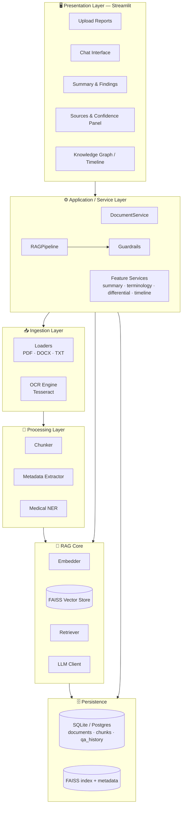
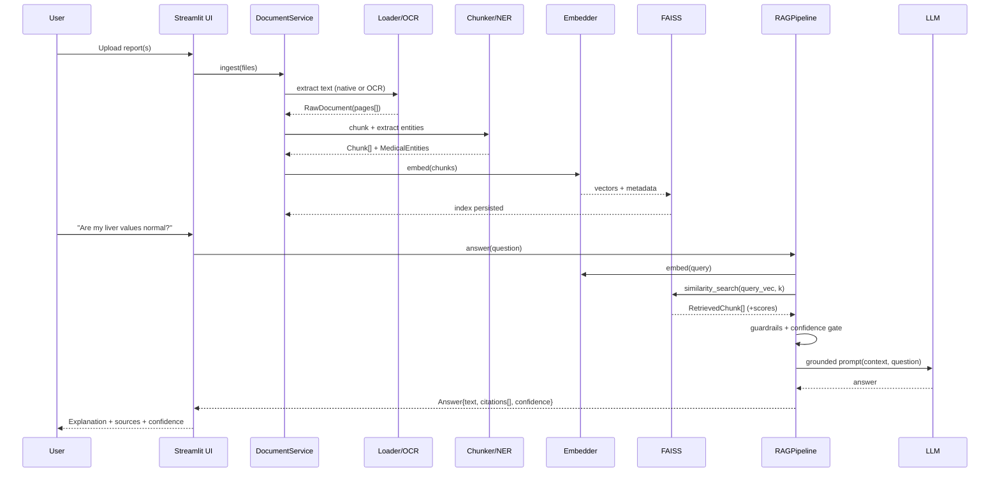
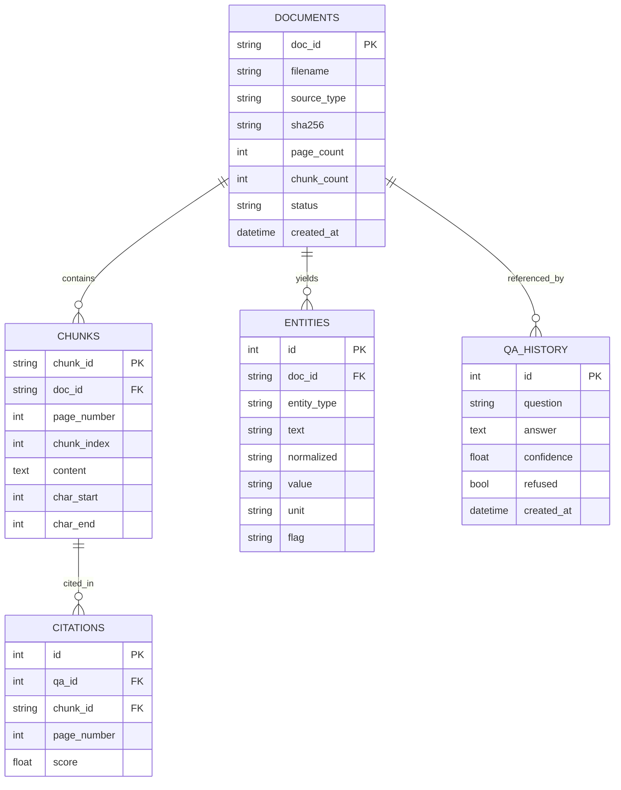

# 🧬 MedIntel AI — Retrieval-Augmented Medical Report Analysis Assistant

> **Upload a medical report. Ask questions. Get medically-grounded, citation-backed,
> easy-to-understand answers — never a hallucination.**

MedIntel AI is a production-grade **Retrieval-Augmented Generation (RAG)** system that
ingests medical documents (PDF, DOCX, TXT, and *scanned* PDFs via OCR), builds a
semantic index, and answers patient questions using **only** the evidence found in the
uploaded reports. Every answer ships with **source citations**, **page numbers**, and a
**confidence score**, and the system **refuses** to answer when the reports don't support a claim.

<p align="center">
  
</p>

---

## ⚠️ Medical Disclaimer

> MedIntel AI is a **decision-support and educational tool**. It is **not** a medical
> device, **not** a substitute for professional medical advice, diagnosis, or treatment,
> and must not be used for clinical decision-making. Always consult a qualified clinician.
> In an emergency, contact your local emergency services immediately.

---

## Table of Contents

1. [Why this project](#-why-this-project)
2. [Feature Matrix](#-feature-matrix)
3. [System Architecture](#-system-architecture)
4. [Data Flow](#-data-flow)
5. [RAG Pipeline](#-rag-pipeline-component-by-component)
6. [Folder Structure](#-folder-structure)
7. [Database & Vector Store Design](#-database--vector-store-design)
8. [API / Service Design](#-api--service-design)
9. [Quickstart](#-quickstart)
10. [Configuration](#-configuration)
11. [Running the App](#-running-the-app)
12. [Docker](#-docker)
13. [Testing](#-testing)
14. [Safety & Guardrails](#-safety--guardrails)
15. [Future Improvements](#-future-improvements)

---

## 🎯 Why this project

Patients routinely receive lab panels, radiology reports, and discharge summaries written
in dense clinical language. Generic LLM chatbots will happily *hallucinate* an
interpretation. MedIntel solves the trust problem with three engineering commitments:

| Principle | Implementation |
|-----------|----------------|
| **Grounded, not guessed** | Answers are generated **only** from retrieved report chunks (RAG). |
| **Auditable** | Every answer cites the source document, page, and exact snippet. |
| **Safe by default** | Confidence gating, emergency detection, refusal of unsupported claims. |

This repository is intentionally built to **production standards** (modular OOP, typing,
config management, logging, error handling, tests, Docker) so it can be showcased to
engineering teams at companies building healthcare AI.

---

## 🧩 Feature Matrix

| Category | Capability | Module |
|----------|-----------|--------|
| Ingestion | PDF / DOCX / TXT loaders | `medintel.ingestion.loaders` |
| Ingestion | OCR for scanned PDFs / images (Tesseract) | `medintel.ingestion.ocr` |
| Processing | Recursive, page-aware chunking | `medintel.processing.chunking` |
| Processing | Structured metadata extraction (labs, meds, dx…) | `medintel.processing.metadata_extractor` |
| Processing | Medical NER (SciSpaCy / MedSpaCy + rules fallback) | `medintel.processing.entity_recognition` |
| RAG | Embeddings (OpenAI / HuggingFace) | `medintel.rag.embeddings` |
| RAG | FAISS vector store (cosine) | `medintel.rag.vector_store` |
| RAG | Semantic retriever + re-ranking | `medintel.rag.retriever` |
| RAG | Grounded answer generation | `medintel.rag.pipeline` |
| Trust | Citation system (doc + page + snippet) | `medintel.models.schemas.Citation` |
| Trust | Confidence scoring | `medintel.features.confidence` |
| Trust | Guardrails (refusal, emergency, disclaimer) | `medintel.features.guardrails` |
| Insight | Multi-level terminology simplifier + ELI5 | `medintel.features.terminology` |
| Insight | Report summary (exec, findings, abnormal, risk) | `medintel.features.summarizer` |
| Insight | Differential diagnosis assistant (educational) | `medintel.features.differential` |
| Insight | Patient timeline generator | `medintel.features.timeline` |
| Insight | Follow-up question generator | `medintel.features.followup` |
| Insight | Knowledge graph (NetworkX + PyVis) | `medintel.features.knowledge_graph` |
| UI | Streamlit healthcare dashboard | `app/streamlit_app.py` |

---

## 🏗 System Architecture



A full-resolution architecture write-up lives in [`docs/ARCHITECTURE.md`](docs/ARCHITECTURE.md).

---

## 🔄 Data Flow



---

## 🧠 RAG Pipeline (component by component)

| # | Stage | What & Why |
|---|-------|------------|
| 1 | **Document Parsing** | Native text extraction (PyMuPDF/pdfplumber/docx) preserves page boundaries needed for citations; OCR recovers text from scans. |
| 2 | **Chunking** | Recursive, page-aware splitting keeps semantically coherent units small enough to embed precisely yet large enough to carry context. Overlap prevents boundary loss. |
| 3 | **Embedding** | Each chunk → dense vector. Captures meaning so "elevated ALT" matches "high liver enzyme". Provider-pluggable (OpenAI / local). |
| 4 | **Vector Storage** | FAISS inner-product over L2-normalized vectors = cosine similarity at scale, persisted to disk with a metadata sidecar. |
| 5 | **Semantic Search** | Query embedded the same way; top-*k* nearest chunks retrieved with similarity scores. |
| 6 | **Context Retrieval** | Retrieved chunks assembled into a bounded, deduplicated, citation-tagged context window. |
| 7 | **Answer Generation** | LLM is constrained by a strict system prompt to answer **only** from context, cite sources, and refuse otherwise. |

Read the deep dive in [`docs/RAG_PIPELINE.md`](docs/RAG_PIPELINE.md).

---

## 📁 Folder Structure

```
AI MED ASSISTANT/
├── app/                          # Streamlit presentation layer
│   ├── streamlit_app.py
│   └── components/               # Reusable UI widgets (sidebar, chat, panels)
├── src/medintel/                 # Installable Python package (src layout)
│   ├── config.py                 # Typed settings (pydantic-settings + YAML + .env)
│   ├── logging_config.py         # Centralized structured logging
│   ├── exceptions.py             # Domain exception hierarchy
│   ├── models/schemas.py         # Pydantic domain models (single source of truth)
│   ├── ingestion/                # loaders.py · ocr.py · document_service.py
│   ├── processing/               # chunking.py · metadata_extractor.py · entity_recognition.py
│   ├── rag/                      # embeddings.py · vector_store.py · retriever.py · prompts.py · pipeline.py
│   ├── llm/                      # client.py (OpenAI + Mock)
│   ├── features/                 # guardrails · confidence · summarizer · terminology
│   │                             # · differential · timeline · followup · knowledge_graph
│   └── storage/                  # database.py (SQLAlchemy models + repository)
├── config/config.yaml            # Non-secret runtime configuration
├── docker/                       # Dockerfile · docker-compose.yml · entrypoint
├── docs/                         # ARCHITECTURE · RAG_PIPELINE · DEPLOYMENT · assets
├── tests/                        # pytest unit + integration tests
├── data/                         # (gitignored) uploads, indexes, db
├── requirements.txt
├── pyproject.toml
├── .env.example
└── README.md
```

---

## 🗄 Database & Vector Store Design

**Relational store** (SQLite by default, Postgres-ready) tracks provenance and history:



**Vector store** — FAISS `IndexFlatIP` over normalized embeddings (cosine). A parallel
JSON sidecar maps each vector row → `Chunk` metadata (doc, page, offsets) so retrieval can
reconstruct citations. See [`docs/ARCHITECTURE.md`](docs/ARCHITECTURE.md#vector-store).

---

## 🔌 API / Service Design

The application layer exposes clean service interfaces (UI-agnostic, easily wrapped in
FastAPI). Core contracts:

```python
DocumentService.ingest(files: list[UploadedFile]) -> list[RawDocument]
RAGPipeline.answer(question: str) -> Answer
SummaryService.generate(doc_id: str | None) -> ReportSummary
TerminologyService.simplify(term: str) -> TerminologySimplification
DifferentialService.suggest() -> list[DifferentialDiagnosis]
TimelineService.build() -> list[TimelineEvent]
KnowledgeGraphService.build() -> Graph
```

See [`docs/API_DESIGN.md`](docs/API_DESIGN.md) for the optional FastAPI surface.

---

## 🚀 Quickstart

```bash
# 1. Clone & enter
cd "AI MED ASSISTANT"

# 2. Create a virtual environment
python -m venv .venv
# Windows
.venv\Scripts\activate
# macOS / Linux
source .venv/bin/activate

# 3. Install (core)
pip install -e .

# 4. (optional) heavy extras: OCR helpers, scispacy, pyvis
pip install -e ".[full]"

# 5. Configure secrets
copy .env.example .env        # Windows  (cp on *nix)
#   → set OPENAI_API_KEY=sk-...

# 6. Launch
streamlit run app/streamlit_app.py
```

> **No OpenAI key / no budget?** MedIntel runs **100% free**. See
> [Free / no-cost usage](#-free--no-cost-usage) below — use a local on-CPU model
> (zero signup) or a free OpenAI-compatible host (e.g. Groq).

System dependency for OCR: install **Tesseract** (`choco install tesseract` on Windows,
`apt-get install tesseract-ocr` on Debian/Ubuntu, `brew install tesseract` on macOS).

---

## ⚙️ Configuration

Configuration is layered, highest priority last:

1. `config/config.yaml` — non-secret defaults
2. Environment variables prefixed `MEDINTEL_` (nested via `__`)
3. `.env` file (secrets)

```bash
MEDINTEL_LLM__PROVIDER=openai          # openai | local | mock
MEDINTEL_LLM__MODEL=gpt-4o-mini
MEDINTEL_EMBEDDINGS__PROVIDER=openai   # openai | huggingface | hash
MEDINTEL_RETRIEVAL__TOP_K=5
MEDINTEL_RETRIEVAL__MIN_CONFIDENCE=0.35
OPENAI_API_KEY=sk-...
```

---

## 💸 Free / no-cost usage

MedIntel does **not** require any paid API. Pick whichever free path suits you:

### Option A — Fully local, zero signup (recommended for "no budget")

Embeddings **and** the LLM run on your machine. No key, no account, offline after
the one-time model download.

```bash
pip install -e ".[local-embeddings,local-llm]"   # sentence-transformers + transformers/torch

# .env (or shell env)
MEDINTEL_LLM__PROVIDER=local
MEDINTEL_LLM__LOCAL_MODEL=Qwen/Qwen2.5-0.5B-Instruct   # bump to 1.5B/3B for quality
MEDINTEL_LLM__MAX_TOKENS=512
MEDINTEL_EMBEDDINGS__PROVIDER=huggingface

streamlit run app/streamlit_app.py
```

| Model | Download | RAM | Speed (CPU) | Quality |
|-------|----------|-----|-------------|---------|
| `Qwen2.5-0.5B-Instruct` (default) | ~1 GB | ~2 GB | fast-ish | decent |
| `Qwen2.5-1.5B-Instruct` | ~3 GB | ~6 GB | slower | better |
| `Qwen2.5-3B-Instruct` | ~6 GB | ~12 GB | slow | best |

> Local generation on CPU takes seconds–minutes per answer. For instant, high-quality
> answers at no cost, use Option B.

### Option B — Free hosted API (fast, high quality, free key — no credit card)

Any **OpenAI-compatible** free host works via `base_url` (e.g. [Groq](https://console.groq.com)):

```bash
MEDINTEL_LLM__PROVIDER=openai
MEDINTEL_LLM__BASE_URL=https://api.groq.com/openai/v1
MEDINTEL_LLM__MODEL=llama-3.3-70b-versatile
OPENAI_API_KEY=<your-free-groq-key>
MEDINTEL_EMBEDDINGS__PROVIDER=huggingface   # keep embeddings free & local
```

### Option C — Mock (CI / smoke tests)

`MEDINTEL_LLM__PROVIDER=mock` + `MEDINTEL_EMBEDDINGS__PROVIDER=hash` — deterministic,
dependency-free, no models. Answers just echo retrieved evidence (used by the test suite).

---

## ▶️ Running the App

```bash
streamlit run app/streamlit_app.py
# → open http://localhost:8501
```

CLI ingestion (headless):

```bash
python -m medintel.cli ingest data/uploads/*.pdf
python -m medintel.cli ask "Are my liver enzymes elevated?"
```

---

## 🐳 Docker

```bash
docker compose -f docker/docker-compose.yml up --build
# → http://localhost:8501
```

The image bundles Tesseract OCR. See [`docs/DEPLOYMENT.md`](docs/DEPLOYMENT.md).

---

## 🧪 Testing

```bash
pytest -q                  # unit + integration
pytest --cov=medintel      # with coverage
ruff check src tests       # lint
mypy src/medintel          # type-check
```

Tests run **offline** using the `MockLLMClient` and a hash-based local embedder, so CI
needs no API keys.

---

## 🛡 Safety & Guardrails

| Guardrail | Behaviour |
|-----------|-----------|
| **Grounding** | Answers restricted to retrieved context via system prompt. |
| **Refusal** | Below-threshold confidence → *"I cannot find evidence for that in the uploaded reports."* |
| **Emergency detection** | Red-flag terms (chest pain, stroke signs, sepsis…) trigger an urgent-care banner. |
| **Disclaimer** | Educational/non-diagnostic notice attached to every answer. |
| **Differential** | Always labelled *"For educational purposes only."* |
| **PII awareness** | Local-first processing; configurable de-identification hook. |

---

## 🔭 Future Improvements

- 🔁 **FastAPI service** + async ingestion workers (Celery/RQ) for horizontal scale.
- 🧱 **pgvector / Qdrant / Milvus** backend behind the `VectorStore` interface for millions of chunks.
- 🧪 **Eval harness** (RAGAS) for faithfulness / answer-relevancy regression gates.
- 🏥 **FHIR / HL7** structured ingestion and SNOMED-CT / LOINC / RxNorm code normalization.
- 🔐 **HIPAA hardening**: audit logging, encryption at rest, RBAC, BAA-covered model hosting.
- 🖼 **Multimodal**: imaging models for DICOM beyond text reports.
- 🌐 **i18n**: multilingual reports + answers.
- 👤 **Human-in-the-loop** clinician review queue.

---

## 📜 License

Released under the MIT License — see [`LICENSE`](LICENSE). Not for clinical use.

---

<p align="center"><sub>Built as a portfolio-grade demonstration of safe, grounded medical RAG engineering.</sub></p>
