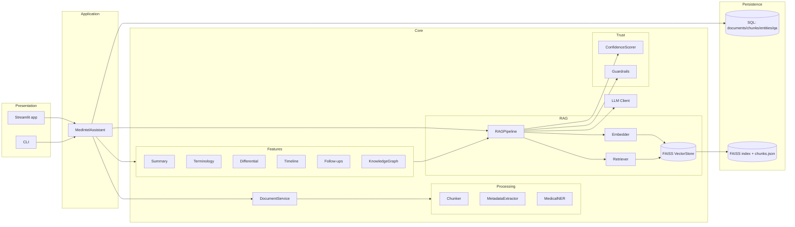
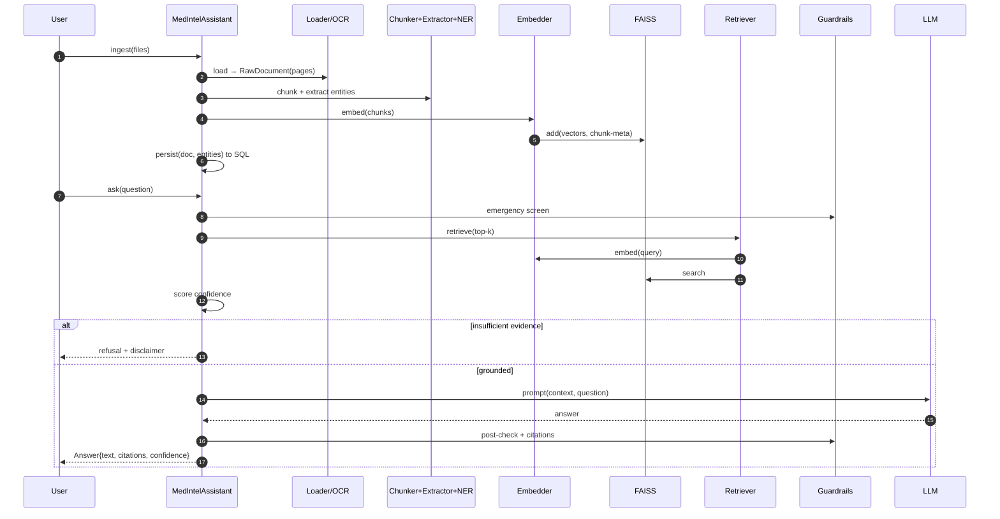

# MedIntel AI — System Architecture

This document describes the architecture, data flow, component responsibilities,
and the database / vector-store design.

---

## 1. Design principles

| Principle | How it shows up in the code |
|-----------|------------------------------|
| **Layered & modular** | `ingestion → processing → rag → features → storage`, each an independent package. |
| **Dependency inversion** | Embedders, LLM clients, and the vector store sit behind interfaces; providers are swapped via config. |
| **Single source of truth** | All data shapes live in `medintel.models.schemas` (Pydantic). |
| **Fail-safe degradation** | Missing OCR / SciSpaCy / API keys degrade gracefully instead of crashing. |
| **Grounded & auditable** | Every answer is traceable to a page + snippet; guardrails gate low-confidence output. |
| **UI-agnostic core** | Streamlit and the CLI both drive the same `MedIntelAssistant` service. |

---

## 2. Component diagram



---

## 3. Layer responsibilities

### 3.1 Ingestion (`medintel.ingestion`)
* **`loaders.py`** — format-specific loaders (PDF/DOCX/TXT/image) producing
  page-segmented `RawDocument`s. A factory (`get_loader`) maps extensions → loader.
* **`ocr.py`** — `OCREngine` wraps Tesseract; renders PDF pages via PyMuPDF and
  reports availability so the system degrades when Tesseract is absent.
* **`document_service.py`** — persists uploads, routes to loaders, validates output.

### 3.2 Processing (`medintel.processing`)
* **`chunking.py`** — page-aware recursive splitting (LangChain splitter w/ native
  fallback). Each `Chunk` carries `doc_id`, `page_number`, `chunk_index`, offsets.
* **`metadata_extractor.py`** — deterministic regex/section parsing of labs and
  headered sections (diagnoses, meds, symptoms, recommendations, notes).
* **`entity_recognition.py`** — `MedicalNER` (SciSpaCy if available, else gazetteer).
* **`vocab.py`** — curated medical lexicons (mirrors an ontology-backed design).

### 3.3 RAG core (`medintel.rag`)
* **`embeddings.py`** — `BaseEmbedder` + OpenAI / HuggingFace / Hash providers.
* **`vector_store.py`** — `FaissVectorStore` (cosine via normalized IP) + sidecar.
* **`retriever.py`** — query embedding, candidate fetch, dedup, top-k.
* **`prompts.py`** — grounding system prompts, context formatting, refusal string.
* **`pipeline.py`** — `RAGPipeline` orchestrating retrieve → gate → generate → cite.

### 3.4 Trust (`medintel.features`)
* **`confidence.py`** — blended retrieval-confidence score + label.
* **`guardrails.py`** — emergency detection, refusal gating, post-gen checks, disclaimer.

### 3.5 Feature services (`medintel.features`)
Summary, terminology simplifier, differential reasoning, timeline, follow-ups,
and knowledge-graph builder — all composing the shared pipeline.

### 3.6 Persistence (`medintel.storage`)
`Repository` over SQLAlchemy models for documents, chunks, entities, Q&A history,
and citations. SQLite by default; Postgres by changing `paths.db_url`.

### 3.7 Application (`medintel.assistant`)
`MedIntelAssistant` — the façade that the UI and CLI use. Holds in-session
knowledge state and wires every service together.

---

## 4. End-to-end data flow



---

## 5. Database design (relational)

ER diagram and rationale (also summarized in the README):

```mermaid
erDiagram
    DOCUMENTS ||--o{ CHUNKS : contains
    DOCUMENTS ||--o{ ENTITIES : yields
    QA_HISTORY ||--o{ CITATIONS : supported_by

    DOCUMENTS { string doc_id PK; string filename; string source_type; string sha256;
                int page_count; int chunk_count; bool used_ocr; string status; datetime created_at }
    CHUNKS    { string chunk_id PK; string doc_id FK; int page_number; int chunk_index;
                int char_start; int char_end; text content }
    ENTITIES  { int id PK; string doc_id FK; string entity_type; string text; string normalized;
                string value; string unit; string reference_range; string flag; int page_number }
    QA_HISTORY{ int id PK; text question; text answer; float confidence; string confidence_label;
                bool refused; datetime created_at }
    CITATIONS { int id PK; int qa_id FK; string filename; int page_number; text snippet; float score }
```

**Why these tables**

* `documents` — provenance + dedup (`sha256`) + processing status.
* `chunks` — chunk metadata for traceability/audits (vectors live in FAISS).
* `entities` — structured extraction enabling summary/timeline/graph/differential
  to work even in a fresh process (`Repository.load_entities`).
* `qa_history` + `citations` — an audit trail of every answer and its evidence,
  essential for a regulated domain.

---

## 6. Vector store design

* **Index**: FAISS `IndexFlatIP` over **L2-normalized** vectors ⇒ inner product =
  cosine similarity. Exact search is ideal at single-patient document volumes.
* **Sidecar**: `chunks.json` maps index row *i* → `Chunk` metadata so retrieval
  reconstructs `filename`/`page_number` for citations. `meta.json` stores the
  embedding `dimension` + provider `signature` to prevent mixing incompatible vectors.
* **Persistence**: `index.faiss` + `chunks.json` + `meta.json` under `paths.index_dir`.
* **Swap-ability**: the `FaissVectorStore` surface (`add`, `search`, `save`, `load`)
  is intentionally minimal so an ANN index (`IndexHNSWFlat`) or an external store
  (pgvector / Qdrant / Milvus) can replace it without touching the retriever.

### Scaling path

| Volume | Backend |
|--------|---------|
| 1 patient / 10³ chunks | `IndexFlatIP` (current) |
| 10⁴–10⁶ chunks | `IndexHNSWFlat` or `IndexIVFFlat` |
| Multi-tenant / 10⁷+ | pgvector / Qdrant / Milvus with per-tenant namespaces |

---

## 7. Configuration & secrets

Layered precedence (low → high): `config/config.yaml` < env vars (`MEDINTEL_*`) <
`.env`. Implemented via a custom lowest-priority YAML settings source so env/.env
always win (see `medintel.config`). Secrets (`OPENAI_API_KEY`) never live in YAML.

---

## 8. Failure & degradation matrix

| Missing capability | Behaviour |
|--------------------|-----------|
| `OPENAI_API_KEY` | Embedder → `HashEmbedder`, LLM → `MockLLMClient` (app still runs). |
| Tesseract | Scanned pages yield no text; native PDFs/DOCX/TXT unaffected. |
| SciSpaCy model | NER falls back to the curated gazetteer matcher. |
| LangChain splitter | Native recursive splitter is used. |
| PyVis | Knowledge graph renders via Plotly instead of interactive HTML. |
