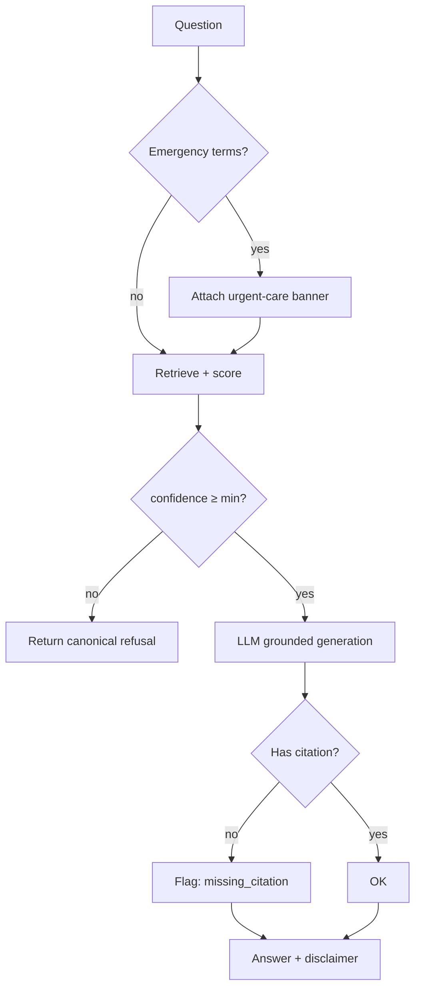

# MedIntel AI — RAG Pipeline Deep Dive

The pipeline turns raw medical documents into grounded, citation-backed answers.
This document explains each stage, the engineering choices, and the safety model.

```
Document → Parse → Chunk → Embed → Store → Retrieve → Assemble Context → Generate → Guard → Cite
```

---

## 1. Document parsing

**Goal:** recover text **while preserving page boundaries** (citations need pages).

* PDFs: PyMuPDF extracts the native text layer per page. If a page has fewer than
  `ocr.min_native_chars_per_page` characters, it is treated as a scan and routed
  to Tesseract OCR (rendered at `ocr.dpi`).
* DOCX: paragraphs + flattened tables (python-docx).
* TXT/MD/CSV: read directly.
* Images: OCR only.

Output: `RawDocument(pages=[Page(page_number, text, extraction_method)])`.

**Why page-aware?** A citation that can't name a page is not auditable. Every
downstream unit keeps its page number from here on.

---

## 2. Chunking

**Goal:** split each page into units small enough to embed precisely, large enough
to retain context.

* Strategy: recursive character splitting on a separator hierarchy
  (`\n\n → \n → sentence → word`) so splits land on natural boundaries.
* Params: `chunk_size=900`, `chunk_overlap=150` (overlap preserves facts that
  straddle a boundary, e.g. a lab name on one line and its value on the next).
* Each `Chunk` records `doc_id`, `filename`, `page_number`, `chunk_index`,
  `char_start/char_end`.

**Why not whole-page embedding?** Large blocks dilute the embedding; a query about
one lab value would match weakly. Chunking sharpens retrieval precision.

---

## 3. Embedding

**Goal:** map text to a vector space where clinical paraphrases are neighbors.

* Default: OpenAI `text-embedding-3-small` (1536-d) — strong quality/cost balance.
* Offline: `sentence-transformers/all-MiniLM-L6-v2` (local) or the dependency-free
  `HashEmbedder` (deterministic; used in CI and as a last-resort fallback).
* Batched (`embeddings.batch_size`) with retry/backoff on transient API errors.

**Why pluggable?** Hospitals may require on-prem/offline models for PHI; the
`BaseEmbedder` interface lets you switch without touching retrieval or generation.

---

## 4. Vector storage

**Goal:** fast, exact similarity search with citation metadata intact.

* FAISS `IndexFlatIP` over L2-normalized vectors ⇒ inner product = cosine.
* Parallel `chunks.json` sidecar maps each row → chunk metadata.
* Scores clamped to `[0, 1]` for an intuitive "relevance %".

See [`ARCHITECTURE.md`](ARCHITECTURE.md#6-vector-store-design) for the scaling path.

---

## 5. Semantic search

**Goal:** fetch the most relevant evidence for a question.

* Query embedded with the **same** embedder (consistency is essential).
* `fetch_k=20` candidates retrieved, then **deduplicated** (near-identical chunks
  from overlapping windows collapse to the highest score), then truncated to `top_k=5`.

---

## 6. Context assembly

**Goal:** build a bounded, citation-tagged prompt context.

* Each retrieved chunk is rendered as `[S1] (file, page, relevance) <text>`.
* The `[S#]` tags are the contract the model uses to cite — and that the pipeline
  parses back out to build `Citation` objects.
* Context is capped by `retrieval.max_context_chars`.

---

## 7. Answer generation

**Goal:** a plain-language answer grounded **only** in the context.

The system prompt (`prompts.GROUNDED_SYSTEM_PROMPT`) enforces:

1. Answer only from context (no outside facts).
2. Cite every claim with `[S#]`.
3. If context is insufficient, reply **exactly** with the refusal sentence.
4. No diagnosis/prescription; explain, don't decide.
5. Plain, compassionate language; flag uncertainty.

Temperature is low (`0.1`) for factual stability.

---

## 8. Guardrails & confidence (the safety layer)



* **Confidence** = `0.65·top + 0.25·mean + 0.10·source_diversity`, labelled
  HIGH / MEDIUM / LOW / INSUFFICIENT against `retrieval.min_confidence` (0.35).
* **Refusal** below threshold returns: *"I cannot find evidence for that in the
  uploaded reports."*
* **Emergency** red-flags (chest pain, stroke signs, sepsis, self-harm…) raise a
  critical banner regardless of report content.
* **Disclaimer** appended to every answer.

---

## 9. Why RAG instead of a fine-tuned / vanilla LLM

| Concern | Vanilla LLM | MedIntel RAG |
|---------|-------------|--------------|
| Hallucination | High risk | Constrained to retrieved text |
| Traceability | None | Page + snippet citations |
| Freshness | Frozen weights | Answers the *user's own* documents |
| Privacy | Prompt leakage risk | Local-first; pluggable on-prem models |
| Auditability | Opaque | Confidence + evidence + Q&A history |

---

## 10. Evaluation hooks (future)

The interfaces are eval-ready: log `(question, retrieved_chunks, answer, citations,
confidence)` and score with RAGAS-style metrics (faithfulness, answer-relevancy,
context-precision/recall) to gate regressions in CI.
